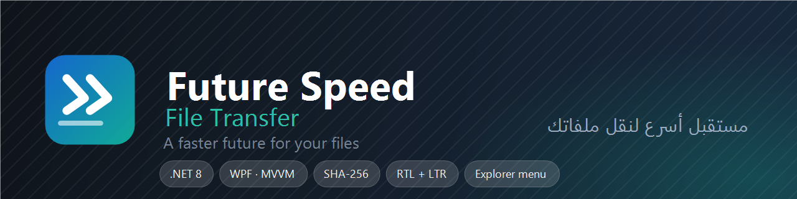
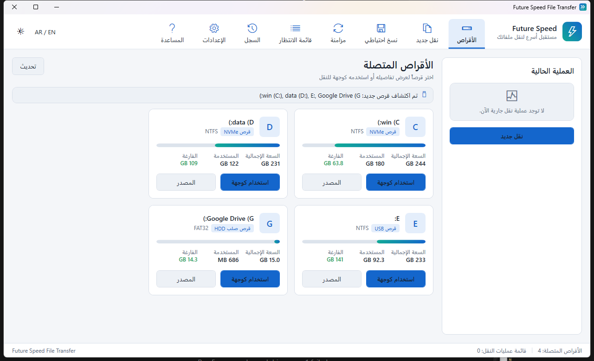
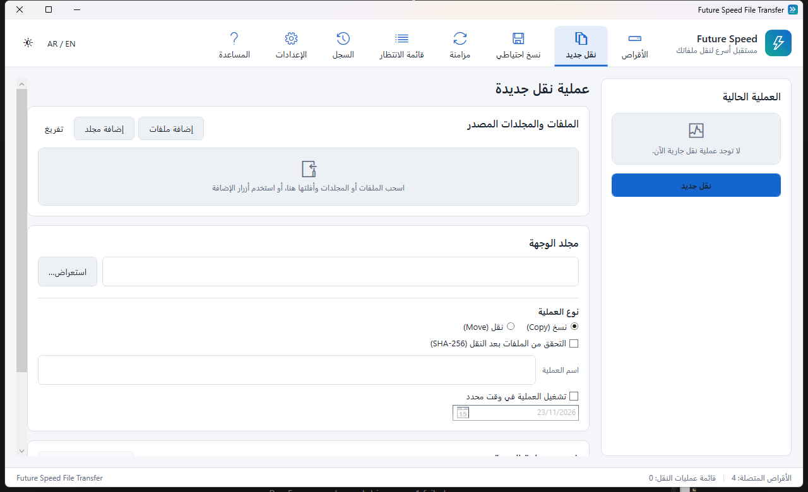
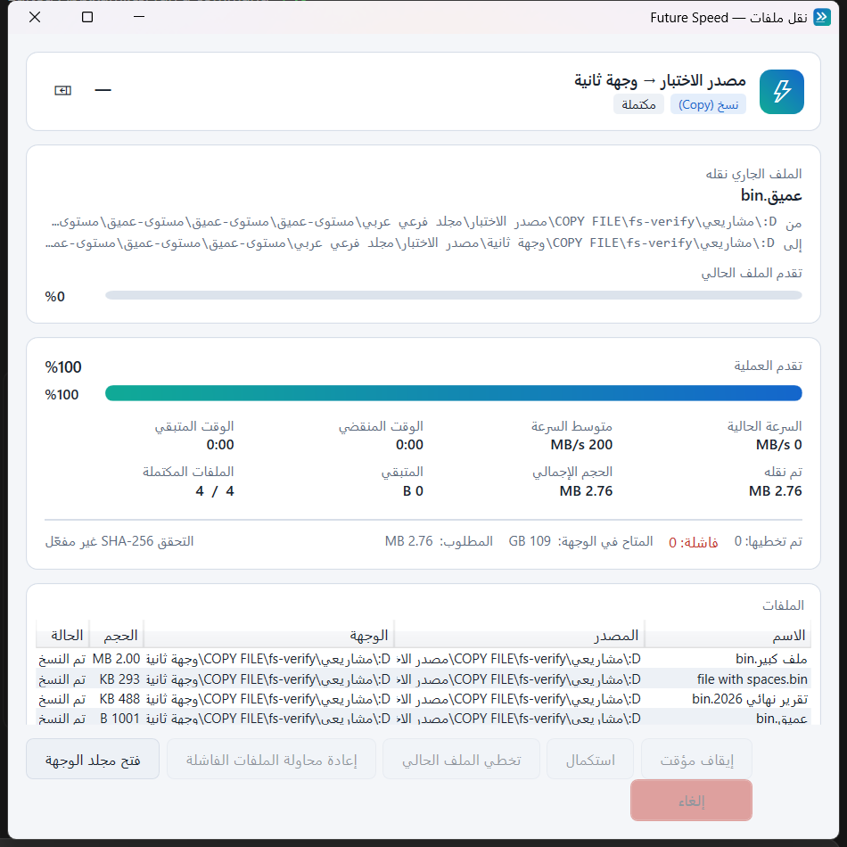
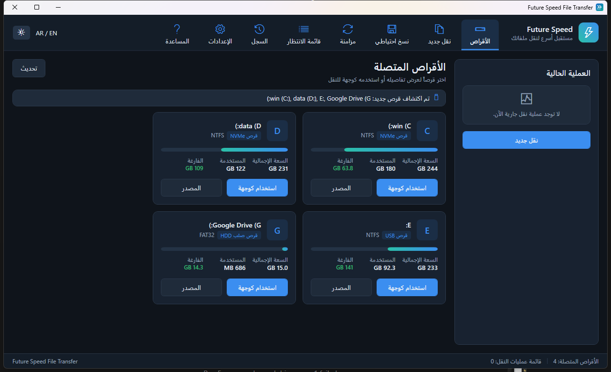
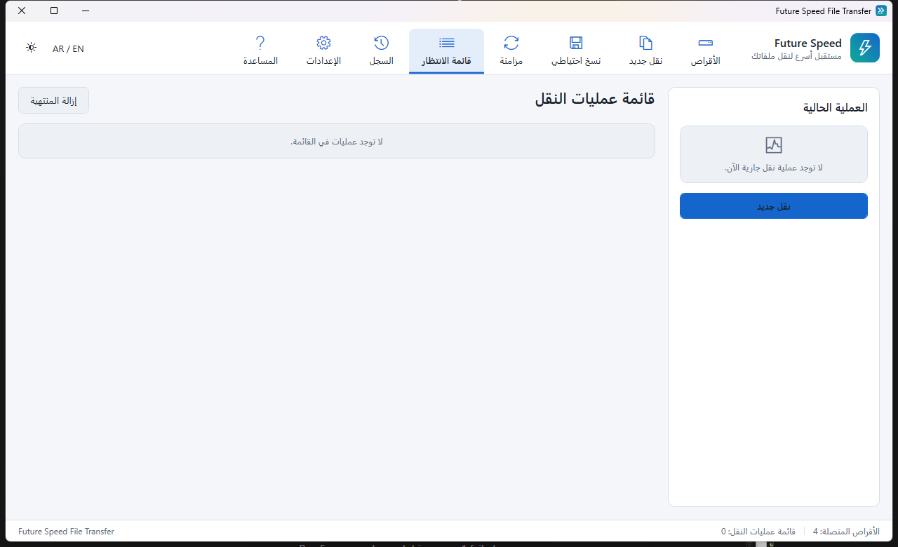
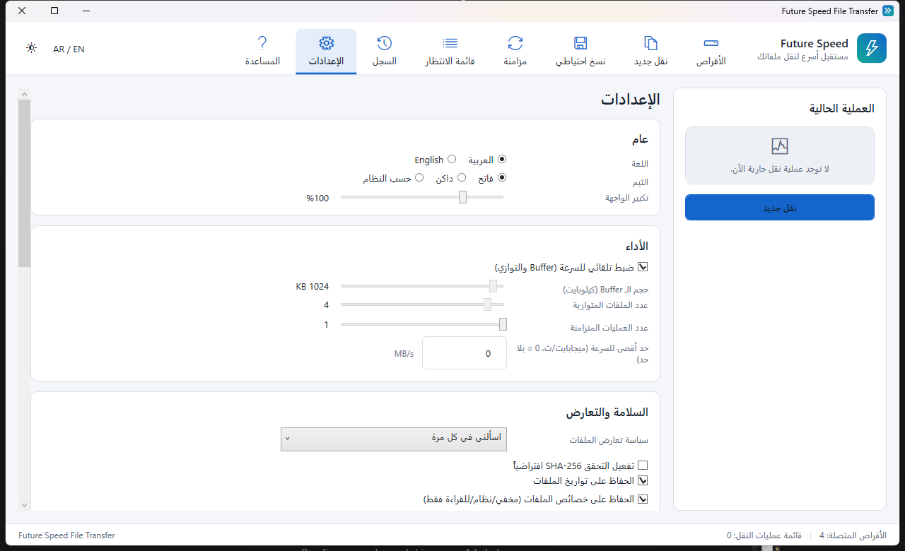

<div align="center">



[](https://dotnet.microsoft.com/download/dotnet/8.0)
[](https://learn.microsoft.com/dotnet/desktop/wpf/)
[](#المتطلبات)
[](#5-البنية-والجودة)
[](LICENSE)
[](CHANGELOG.md)

برنامج سطح مكتب لويندوز لنقل ونسخ الملفات والمجلدات بسرعة عالية، مع تحقق كامل من سلامة
البيانات، وواجهة عربية RTL قابلة للتحويل إلى الإنجليزية LTR، ووضع فاتح وداكن،
وتكامل اختياري مع قائمة مستكشف الملفات.



</div>

---

## لماذا هذا البرنامج؟

| | |
|---|---|
| 🛡️ **لا يفقد ملفاً** | في وضع النقل لا يُحذف الأصل إلا بعد نجاح النسخ وتطابق بصمة SHA-256، وكل ملف يُكتب في ملف مؤقت ثم يُعاد تسميته فلا تبقى ملفات ناقصة |
| 📏 **يمنع الكارثة قبل وقوعها** | يحسب الحجم المطلوب ويقارنه بالمساحة الحقيقية، ويمنع البدء إذا كانت غير كافية بدل أن يتوقف في المنتصف |
| ⚙️ **يضبط نفسه حسب القرص** | NVMe / SSD / HDD / USB / شبكة — حجم الـ Buffer وعدد الملفات المتوازية يُختاران تلقائياً |
| 📊 **أرقام تُقرأ لا تقفز** | السرعة والوقت المتبقي بمتوسط متحرك أسي، لا قيم تتغير كل ثانية |
| ⏸️ **تحكم كامل** | إيقاف مؤقت، استكمال، تخطي الملف الحالي، إلغاء آمن، وإعادة محاولة الملفات الفاشلة وحدها |
| 🔁 **يُستأنف بعد الانقطاع** | حالة كل عملية تُحفظ كل 3 ثوانٍ، ولا تُنسخ الملفات المكتملة مرتين |
| 🖱️ **يندمج مع ويندوز** | أوامر «نسخ / نقل / لصق بواسطة Future Speed» في قائمة الزر الأيمن — اختيارية وقابلة للإلغاء بالكامل |
| 🌍 **عربي أولاً** | RTL كامل مع تبديل فوري للإنجليزية، ودعم المسارات العربية والطويلة جداً |

---

## البدء السريع

### تثبيت جاهز
نزّل أحدث `FutureSpeed-x.y.z-Setup.exe` من صفحة **[Releases](../../releases)** وشغّله.
لا يحتاج تثبيت .NET على الجهاز (نسخة مستقلة)، ولا يطلب صلاحيات مدير.

### بناء من المصدر

```powershell
git clone https://github.com/hossamxp2025/Future-Speed.git
cd Future-Speed
dotnet build FutureSpeed.sln
dotnet run --project src\FutureSpeed.App\FutureSpeed.App.csproj
```

يكفي **[.NET 8 SDK](https://dotnet.microsoft.com/download/dotnet/8.0)**
(`winget install Microsoft.DotNet.SDK.8`). التفاصيل الكاملة في [القسم 2](#2-التشغيل-والبناء).

### سطر الأوامر

```powershell
FutureSpeed.exe --copy "D:\مصدر" --destination "E:\وجهة" --compact
FutureSpeed.exe --move "D:\ملف.bin" --destination "E:\وجهة"
FutureSpeed.exe --paste-to "E:\وجهة" --compact      # ينقل ما في الحافظة
FutureSpeed.exe --register-explorer                 # تفعيل أوامر قائمة Explorer
FutureSpeed.exe --unregister-explorer               # إلغاؤها بالكامل
```

---

## لقطات الشاشة

| الأقراص | نقل جديد |
|---|---|
|  |  |

| نافذة النقل المصغرة (من Explorer) | الوضع الداكن |
|---|---|
|  |  |

| قائمة الانتظار | الإعدادات |
|---|---|
|  |  |

> دليل الاستخدام الكامل بالصور: **[docs/دليل-الاستخدام.md](docs/دليل-الاستخدام.md)**
> وسجل التغييرات: **[CHANGELOG.md](CHANGELOG.md)**

---

## In English, briefly

Future Speed File Transfer is a Windows desktop app for fast, verified file and folder
transfers, built with **C# / .NET 8 / WPF / MVVM**. It ships a full Arabic RTL interface
that switches to English LTR instantly, light and dark themes, SHA-256 verification,
resumable jobs, a transfer queue, folder sync, file-level backup, and an optional
File Explorer context-menu integration (HKCU registry keys only — no shell extension DLL,
no hooks, fully reversible). Everything below is documented in Arabic; the code,
the architecture and the tests are language-neutral.

- **Engine:** `src/FutureSpeed.Core` — no UI dependency, 189 tests
- **UI:** `src/FutureSpeed.App` — WPF, 29 tests
- **Build:** `dotnet build FutureSpeed.sln` · **Test:** `dotnet test FutureSpeed.sln`
- **License:** MIT

---

- **الاسم التنفيذي:** `FutureSpeed.exe`
- **التقنيات:** C# · .NET 8 · WPF · MVVM · Dependency Injection
- **الترخيص:** [MIT](LICENSE) — وجميع المكتبات المستعملة مفتوحة المصدر ومجانية (القائمة في الأسفل)

---

## 1. المحتويات

```
FutureSpeed/
├── FutureSpeed.sln
├── Directory.Build.props                 إعدادات مشتركة لكل المشاريع
├── README.md
├── build/
│   ├── make-icon.ps1                     توليد أيقونة البرنامج (هوية أصلية)
│   ├── publish.ps1                       نشر نسخة Release جاهزة للتوزيع
│   └── make-installer.ps1                نشر + بناء ملف التثبيت
├── installer/
│   └── FutureSpeed.iss                   سكربت Inno Setup
├── src/
│   ├── FutureSpeed.Core/                 محرك النقل — لا يعتمد على الواجهة إطلاقاً
│   │   ├── Abstractions/                 الواجهات (Scanner, Drives, Engine, Hash, ...)
│   │   ├── Models/                       TransferJob, TransferOptions, TransferProgress, ...
│   │   ├── Services/                     DriveService, FileSystemScanner, SpaceValidator,
│   │   │                                 Sha256HashService, ConflictStrategy, ReportService,
│   │   │                                 JsonJobStateStore, SyncService, BackupService
│   │   ├── Integration/                  سطر الأوامر، الحافظة، مفاتيح Explorer، IPC
│   │   ├── Transfer/                     TransferEngine, TransferQueue, الاستثناءات
│   │   └── Utils/                        PathUtils, SpeedCalculator, RateLimiter,
│   │                                     TransferTuner, PauseToken, ByteFormatter
│   └── FutureSpeed.App/                  واجهة WPF
│       ├── App.xaml(.cs)                 التهيئة + DI + Serilog + معالجة الاستثناءات
│       ├── app.manifest                  DPI لكل شاشة + دعم المسارات الطويلة + asInvoker
│       ├── Assets/                       الأيقونة (تُولَّد بالسكربت)
│       ├── Converters/                   محولات العرض (حجم، سرعة، مدة، نسبة، تسميات)
│       ├── Localization/                 LocalizationService + Strings (عربي/إنجليزي)
│       ├── Services/                     الإعدادات، الثيم، الحوارات، الإشعارات، الصلاحيات،
│       │                                 مراقبة الأقراص، البيانات التجريبية، التنقل
│       ├── Themes/                       Palette.Light / Palette.Dark / Styles
│       ├── ViewModels/                   Main, Drives, NewTransfer, Queue, History,
│       │                                 Backup, Sync, Settings, Help, JobItem
│       └── Views/                        الشاشات + النافذة المصغرة + حوارا التعارض والمساحة
└── tests/
    └── FutureSpeed.Core.Tests/
        ├── Unit/                         المساحة، السرعة وETA، التعارض، المسارات، الضبط
        └── Integration/                  النسخ، النقل، الإيقاف، الاستكمال، الإلغاء، القائمة
```

---

## 2. التشغيل والبناء

### المتطلبات
- Windows 10 بإصدار 1809 أو أحدث (أو Windows 11)
- [.NET 8 SDK](https://dotnet.microsoft.com/download/dotnet/8.0) للبناء فقط
  (`winget install Microsoft.DotNet.SDK.8`)

### بناء وتشغيل نسخة التطوير

```powershell
dotnet build FutureSpeed.sln
dotnet run --project src\FutureSpeed.App\FutureSpeed.App.csproj
```

### تشغيل الاختبارات

```powershell
dotnet test tests\FutureSpeed.Core.Tests\FutureSpeed.Core.Tests.csproj
```

### نشر نسخة Release

```powershell
powershell -ExecutionPolicy Bypass -File build\publish.ps1
```

تُنتج مجلداً مستقلاً في `artifacts\publish\win-x64` لا يحتاج تثبيت .NET على جهاز المستخدم
(Self-contained، حوالي 146 ميجابايت). للحصول على نسخة صغيرة تعتمد على
.NET 8 Desktop Runtime المثبّت مسبقاً:

```powershell
powershell -ExecutionPolicy Bypass -File build\publish.ps1 -SelfContained $false
```

---

## 3. إنشاء ملف التثبيت

يستخدم المشروع **Inno Setup 6** (مجاني ومفتوح المصدر):

```powershell
winget install JRSoftware.InnoSetup
```

ثم:

```powershell
powershell -ExecutionPolicy Bypass -File build\make-installer.ps1
```

السكربت ينشر البرنامج ثم يترجم `installer\FutureSpeed.iss`، والناتج:

```
artifacts\installer\FutureSpeed-1.1.0-Setup.exe
```

خصائص ملف التثبيت: تثبيت لكل مستخدم أو لكل الجهاز (المستخدم يختار، فلا يُطلب رفع الصلاحيات بلا
داعٍ)، لغتان عربية وإنجليزية، اختصار في قائمة ابدأ واختياري على سطح المكتب، وإلغاء تثبيت نظيف
**لا يحذف** سجلات المستخدم وتقاريره في `%APPDATA%\FutureSpeed`.

لترجمة السكربت يدوياً:

```powershell
& "C:\Program Files (x86)\Inno Setup 6\ISCC.exe" installer\FutureSpeed.iss
```

---

## 4. الخصائص المنفَّذة

### نقل ونسخ الملفات
- اختيار ملفات متعددة أو مجلدات كاملة، مع **السحب والإفلات** على أي مكان في النافذة.
- وضعا **Copy** و**Move**، مع الحفاظ على بنية المجلدات (بما فيها المجلدات الفارغة).
- الحفاظ على تواريخ الإنشاء/التعديل/الوصول وخصائص الملفات (مخفي، نظام، للقراءة فقط، أرشيف).
- دعم **المسارات الطويلة** (بادئة `\\?\` في كل عمليات الملفات + `longPathAware` في الـ manifest).
- دعم الملفات الضخمة دون استهلاك الذاكرة: حجم الـ buffer ثابت ومحدود مهما كان حجم الملف.
- تجاهل آمن للـ junctions/symlinks أثناء الفحص لمنع الحلقات اللانهائية.
- في وضع Move لا يُحذف المصدر إلا بعد نجاح النسخ، وبعد تطابق SHA-256 إن كان التحقق مفعلاً.

### السرعة والأداء
- `FileStream` بوضع `Asynchronous | SequentialScan` وحجز مساحة الملف مسبقاً (`PreallocationSize`).
- `ArrayPool` لمخازن النسخ، فلا ضغط على الـ GC في عمليات ضخمة.
- ضبط تلقائي لحجم الـ Buffer وعدد العمليات المتوازية حسب نوع القرص
  (NVMe / SSD / HDD / USB / شبكة / ضوئي) — يُكتشف النوع عبر WMI مع تدرّج آمن عند الفشل.
  القرص الصلب التقليدي يعمل بملف واحد في كل مرة (التوازي يُبطئه بسبب الـ seek).
- وضع يدوي كامل: حجم Buffer من 4KB إلى 16MB، وتوازي من 1 إلى 32 ملفاً.
- حد أقصى اختياري للسرعة (Token Bucket مشترك بين كل العمال).
- الواجهة لا تتجمد: كل العمل I/O غير متزامن، والتحديثات تُنشر 4 مرات في الثانية فقط.

### معلومات النقل المباشرة
نسبة الإنجاز، شريط تقدم، السرعة الحالية، متوسط السرعة، الوقت المنقضي، الوقت المتبقي (ETA)،
الحجم الإجمالي، المنقول، المتبقي، عدد الملفات المكتملة/المتبقية/المتخطاة/الفاشلة، واسم الملف
الجاري نقله ومساره الكامل. السرعة وETA يُحسبان بمتوسط متحرك أسي (EMA) مع مزج مع المتوسط
العام، فلا تقفز القيم كل ثانية.

### التحقق من مساحة الوجهة
- حساب الحجم الإجمالي الحقيقي قبل البدء، مع مراعاة الملفات الموجودة مسبقاً وسياسة الاستبدال
  (المتخطّى لا يُحسب، والاستبدال يُحسب بالكامل، و«اسألني» تُحسب كأسوأ حالة).
- هامش أمان 32 ميجابايت لبيانات نظام الملفات.
- **يُمنع بدء النقل تماماً** عند عدم كفاية المساحة، مع عرض المطلوب والمتاح والناقص.
- التجاوز متاح **فقط** حين يتعذّر تحديد الحجم أو المساحة، مع تحذير واضح.

### التحكم في العملية
بدء، إيقاف مؤقت، استكمال، إلغاء، وإعادة محاولة الملفات الفاشلة وحدها. فشل ملف واحد لا يوقف
البقية، ويُسجَّل سبب الفشل. الإلغاء وحذف الملفات الزائدة يحتاجان تأكيداً من المستخدم.
امتلاء القرص أو فصل وحدة USB يوقف العملية بأمان برسالة واضحة بدل سلسلة أخطاء.

### تعارض الملفات
استبدال، تخطي، إعادة تسمية تلقائية (`file (2).ext`)، الاحتفاظ بالأحدث، أو الاستبدال عند اختلاف
الحجم/التاريخ — مع خيار «تطبيق على الكل». حوار التعارض يعرض الحجم والتاريخ للجانبين وحكماً
مختصراً (متطابقان / المصدر أحدث / الوجهة أحدث). لا يُستبدل أي ملف دون موافقة أو سياسة مختارة
مسبقاً، وإغلاق الحوار دون اختيار يعني «تخطي» وليس «استبدال».

### سلامة البيانات
- تحقق اختياري بـ **SHA-256** للمصدر والوجهة بعد كل ملف، ويُحذف الملف الناتج عند عدم التطابق.
- كل ملف يُكتب أولاً باسم مؤقت `*.fspart` ثم يُعاد تسميته عند النجاح، فلا تبقى ملفات ناقصة.
- تقارير بصيغة **JSON / CSV / TXT** تشمل كل ملف ونتيجته وبصمته وسبب فشله، وتُحفظ تلقائياً
  بعد كل عملية (قابل للإيقاف).
- Structured Logging عبر Serilog إلى ملفات يومية (يُحتفظ بـ 14 يوماً).

### استكمال العمليات
حالة كل عملية تُحفظ في `%APPDATA%\FutureSpeed\state` كل 3 ثوانٍ بكتابة ذرّية (ملف مؤقت ثم
إعادة تسمية). عند التشغيل التالي يعرض البرنامج العمليات غير المكتملة ويعرض استكمالها، فلا
تُنسخ الملفات المكتملة مرة أخرى. سجل بآخر العمليات وحالتها متاح في شاشة «السجل».

### قائمة الانتظار والجدولة
عدة عمليات في قائمة واحدة، مع تقديم/تأخير وتغيير الأولوية، وعدد عمليات متزامنة قابل للضبط
(1 افتراضياً لأن التوازي بين عمليتين على القرص نفسه يُبطئهما)، وجدولة بدء العملية في وقت محدد.

### المزامنة والنسخ الاحتياطي
- مزامنة مجلدين: باتجاه واحد، باتجاهين (الأحدث يفوز)، أو مطابقة كاملة مع عرض الملفات الزائدة
  وحذفها بعد تأكيد صريح.
- نسخ احتياطي على مستوى الملفات: كل تشغيل ينشئ مجموعة بطابع زمني مع ملف
  `futurespeed-backup.json` يصف محتواها وبصماتها، وقائمة بالمجموعات المحفوظة.
- **Disk Imaging / Cloning:** البنية جاهزة (`IDiskImagingProvider`) لكن التنفيذ **غير مفعّل**
  في هذه النسخة عمداً — الكتابة المباشرة على الأقراص تحتاج لقطة VSS وصلاحيات مرتفعة واختبارات
  مستقلة، والنسخة الحالية تعرض السبب بوضوح بدل تقديم وظيفة وهمية.

### تكامل Windows ونافذة النقل المصغرة (جديد في 1.1.0)
- **أوامر في قائمة مستكشف الملفات** (اختيارية، وتُفعّل من الإعدادات أو أثناء التثبيت):
  «نسخ بواسطة Future Speed» و«نقل بواسطة Future Speed» على الملفات والمجلدات، و«لصق بواسطة
  Future Speed» على المجلد أو خلفيته. تعمل مع تحديد عدة عناصر، وتظهر في ويندوز 11 داخل
  «إظهار المزيد من الخيارات».
- التكامل **مفاتيح Registry فقط تحت HKCU** — بلا صلاحيات مدير، وبلا أي DLL أو مكوّن داخل
  Explorer، وإلغاؤه يحذف المفاتيح كاملة.
- أمرا النسخ/النقل يضعان التحديد في حافظة ويندوز بالعلامة الصحيحة (Copy/Cut)، وأمر اللصق
  يقرأ `CF_HDROP` و`Preferred DropEffect` فقط — ولا يُلمس نسخ النصوص أو الصور إطلاقاً.
- **نافذة نقل مصغرة** تُفتح وحدها عند التشغيل من Explorer (لا تفتح النافذة الرئيسية):
  الملف الحالي ومصدره ووجهته، شريط تقدم للملف وآخر للعملية مع النسبة، السرعة الحالية
  والمتوسط، الوقت المنقضي والمتبقي، المنقول/الإجمالي/المتبقي، عدّادات الملفات، قائمة بكل
  الملفات وحالتها، مساحة الوجهة المتاحة والمطلوبة، وحالة التحقق SHA-256.
  أزرارها: إيقاف مؤقت، استكمال، **تخطي الملف الحالي**، إعادة محاولة الفاشلة، فتح مجلد
  الوجهة، فتح النافذة الرئيسية، والتصغير إلى منطقة الإشعارات.
- **نسخة واحدة فقط** من البرنامج: كل استدعاء جديد من Explorer يُمرَّر عبر Named Pipe إلى
  النسخة العاملة، فلا يوجد محركان لنفس العملية، ويمكن أن تعمل عدة عمليات مستقلة بالتوازي.
- سطر الأوامر: `--copy` و`--move` و`--paste-to` و`--sources-file` و`--compact`
  و`--register-explorer` و`--unregister-explorer`.

### الواجهة
شريط علوي بأزرار كبيرة (الأقراص، نقل جديد، نسخ احتياطي، مزامنة، قائمة الانتظار، السجل،
الإعدادات، المساعدة)، لوحة جانبية للعملية الحالية بكل مؤشراتها، ومساحة رئيسية تعرض الأقراص
كبطاقات (الاسم والحرف، نظام الملفات، السعة، المستخدمة، الفارغة، شريط استخدام، ونوع القرص).
دعم كامل للعربية RTL والإنجليزية LTR مع تبديل فوري، ووضع فاتح وداكن، وتكبير الواجهة من 80%
إلى 160%، وDPI لكل شاشة. اكتشاف الأقراص الخارجية عند توصيلها أو فصلها خلال ثانيتين.

### الإعدادات
اللغة، الثيم، تكبير الواجهة، الضبط التلقائي للسرعة، حجم Buffer، عدد الملفات المتوازية، عدد
العمليات المتزامنة، تفعيل SHA-256، سياسة التعارض، حد السرعة، الحفاظ على التواريخ والخصائص،
تمكين الاستكمال، الإشعار الصوتي، إشعار Windows، فتح مجلد الوجهة بعد الانتهاء، صيغة التقرير
الافتراضية، ومسارات السجلات والتقارير والنسخ الاحتياطي. زر لإنشاء **بيانات تجريبية** في مجلد
البرنامج المؤقت لاختبار الواجهة دون المساس بملفات المستخدم.

### الأمان والصلاحيات
- البرنامج يعمل بصلاحيات المستخدم العادي (`asInvoker`)، ويطلب رفع الصلاحيات **فقط** عندما يرفض
  مجلد الوجهة الكتابة فعلياً (يُختبر بكتابة ملف تجريبي).
- `PathUtils.CombineSecure` يمنع Path Traversal: أي مسار نسبي يخرج خارج مجلد الوجهة يُرفض.
- يُرفض اختيار وجهة هي المصدر نفسه أو داخله.

---

## 5. البنية والجودة

- **فصل كامل** بين المحرك (`FutureSpeed.Core`, لا يعرف شيئاً عن WPF) والواجهة.
- **MVVM** عبر CommunityToolkit.Mvvm، و**DI** عبر Microsoft.Extensions.DependencyInjection مع
  `ValidateOnBuild` حتى تُكتشف أخطاء التركيب عند الإقلاع لا أثناء الاستخدام.
- واجهات واضحة لكل خدمة (SOLID)، وكل منطق قابل للاختبار مُفصول عن الـ I/O
  (مثل `ConflictStrategy` و`SpeedCalculator` الذي يأخذ `TimeProvider`).
- معالجة شاملة للاستثناءات: معالج على مستوى الـ Dispatcher والـ AppDomain والمهام غير المراقَبة،
  وخطأ في عملية واحدة لا يُسقط البرنامج.
- **218 اختباراً** تمر بالكامل (189 في النواة + 29 في طبقة التطبيق): وحدات (المساحة، السرعة وETA، التعارض، المسارات ومنع Traversal،
  ضبط الأداء، التنسيق، الإيقاف المؤقت، حد السرعة) وتكامل (نسخ شجرة كاملة، التواريخ والخصائص،
  Move مع التحقق، سياسات التعارض، منع البدء عند نقص المساحة، الإلغاء دون ملفات ناقصة،
  الإيقاف والاستكمال، نقاط الاستعادة، ملف مقفول لا يوقف البقية، المزامنة، التقارير، القائمة)، إضافة إلى اختبارات الخاصية الجديدة: تحليل سطر الأوامر بالمسارات العربية والمسافات، قراءة الحافظة والتمييز بين Copy وCut، تجاهل الحافظة غير المحتوية على ملفات، مفاتيح Registry وتثبيتها وإزالتها دون بقايا، فشل التكامل دون تعطيل التطبيق، Named Pipes وتعدد الطلبات، تخطي الملف الحالي، التحديد المتعدد ومنع التكرار، وعدم كتابة أي مفتاح دون موافقة.

### المكتبات الخارجية (كلها مفتوحة المصدر)

| المكتبة | الاستخدام | الترخيص |
|---|---|---|
| CommunityToolkit.Mvvm 8.2.2 | ObservableObject و RelayCommand | MIT |
| Microsoft.Extensions.DependencyInjection 8.0.1 | حاوية الحقن | MIT |
| Microsoft.Extensions.Logging(.Abstractions) 8.0.x | تجريد التسجيل | MIT |
| Serilog.Extensions.Logging 8.0.0 + Sinks.File 5.0.0 + Sinks.Console 5.0.1 | Structured Logging | Apache-2.0 |
| System.Management 8.0.0 | قراءة نوع القرص (SSD/NVMe/USB) | MIT |
| xunit 2.9.2 + runner.visualstudio + Microsoft.NET.Test.Sdk | الاختبارات | Apache-2.0 / MIT |
| Microsoft.Extensions.TimeProvider.Testing 8.10.0 | ساعة وهمية لاختبار السرعة وETA | MIT |
| Inno Setup 6 (أداة بناء فقط) | ملف التثبيت | رخصة Inno Setup (مجانية) |
| System.IO.Pipes / Microsoft.Win32.Registry | جزء من .NET 8 — التواصل بين النسخ وتكامل Explorer | MIT |

> WPF و Windows Forms (المستعملة فقط لأيقونة الإشعارات في شريط المهام) جزء من .NET 8 نفسه.

---

## 6. القيود التقنية المتبقية

1. **Future Speed ليس «الناسخ الافتراضي» لويندوز.** لا توفّر ويندوز 10/11 أي واجهة مدعومة
   لاستبدال محرك النسخ أو اعتراض Ctrl+V في مستكشف الملفات؛ الطرق المتداولة لذلك (حقن DLL
   داخل explorer.exe أو Keyboard Hook عام) غير آمنة وتكسر Explorer وتؤثر في نسخ النصوص في
   كل البرامج، ولم تُستخدم هنا. المتاح رسمياً هو **أوامر قائمة Explorer**، وهو المنفَّذ.
   يبقى Ctrl+C وCtrl+V سلوك ويندوز الطبيعي تماماً.
2. **قائمة ويندوز 11 الحديثة**: إظهار أمر في القائمة الأولى يحتاج حزمة MSIX موقّعة
   (Sparse Package) مع مكوّن IExplorerCommand. النسخة الحالية تُثبَّت كتطبيق عادي بـ Inno
   Setup، فتظهر أوامرها في «إظهار المزيد من الخيارات».
3. **Disk Imaging / Cloning غير منفّذ** — موجود كواجهة وبنية فقط، لأن الكتابة الخام على الأقراص
   تحتاج VSS وصلاحيات مرتفعة واختبارات على أجهزة حقيقية؛ النسخة الأولى لا تنفّذ عمليات خطرة
   غير مختبَرة.
4. **إشعارات Windows** تُعرض عبر أيقونة في شريط المهام (Balloon/Toast). هذا يعمل بلا حزم
   خارجية، لكنه لا يدعم أزرار التفاعل داخل الإشعار كما في حزم Toast المتقدمة.
5. **استكمال العمليات على مستوى الملف لا البايت** — الملف الذي انقطع أثناء نسخه يُعاد من
   بدايته (ملفه المؤقت يُحذف)، أما الملفات المكتملة فلا تُنسخ ثانية.
6. **اكتشاف نوع القرص** يعتمد على WMI؛ إن فشل الاستعلام يُعامل القرص كقرص صلب تقليدي
   (الخيار الأكثر تحفظاً) وقد تكون السرعة أقل من الممكن على SSD.
7. **المزامنة ثنائية الاتجاه** تعتمد على الحجم وتاريخ التعديل، ولا تحتفظ بتاريخ تغييرات
   (فلا تستطيع التمييز بين «تعديل» و«حذف ثم إنشاء»).
8. **مراقبة الأقراص** بالاستقصاء كل ثانيتين، لا بأحداث WMI فورية.
9. النسخة مبنية لـ **x64** فقط (يمكن إضافة ARM64 بتغيير `-r` في سكربت النشر).

---

## 7. أين تُحفظ بيانات البرنامج

```
%APPDATA%\FutureSpeed\
├── settings.json        الإعدادات
├── logs\                سجلات يومية (14 يوماً)
├── reports\             تقارير العمليات (JSON/CSV/TXT)
├── state\               نقاط استعادة العمليات غير المكتملة
└── demo-data\           البيانات التجريبية (إن أُنشئت)
```

لا يحذف إلغاء التثبيت هذا المجلد.

---

## 8. المساهمة

المشروع مفتوح للمساهمات. قبل فتح Pull Request:

1. `dotnet build FutureSpeed.sln` — يجب أن يمر بـ **0 أخطاء و0 تحذيرات**.
2. `dotnet test FutureSpeed.sln` — يجب أن تمر **كل** الاختبارات.
3. أي سلوك جديد يحتاج اختباراً يغطيه؛ المنطق القابل للاختبار يوضع في `FutureSpeed.Core`
   بعيداً عن الواجهة.
4. حافظ على فصل الطبقات: `Core` لا يعرف شيئاً عن WPF، والواجهة لا تنفّذ منطق نقل.

تفاصيل أكثر في [CONTRIBUTING.md](CONTRIBUTING.md).

## 9. الترخيص

هذا المشروع مرخّص بموجب رخصة **MIT** — انظر ملف [LICENSE](LICENSE).

يمكنك استخدامه وتعديله وتوزيعه وبيعه، بشرط الإبقاء على إشعار حقوق النشر والترخيص.
البرنامج يُقدَّم «كما هو» دون أي ضمان.

## 10. تنبيه

الهوية البصرية (الاسم والشعار والأيقونة والألوان) أصلية بالكامل ولا تنتمي لأي منتج آخر.
أي تشابه في **تنظيم المعلومات** مع برامج النسخ الأخرى هو تشابه وظيفي طبيعي، ولم يُنسخ أي
كود أو أصول من أي منتج.
