# دليل استخدام Future Speed File Transfer

> **مستقبل أسرع لنقل ملفاتك**

هذا الدليل يشرح كل شاشة في البرنامج وماذا يفعل كل زر، ثم يعطيك سيناريوهات عملية جاهزة.
الصور مأخوذة من البرنامج نفسه بالواجهة العربية.

---

## المحتويات

1. [تخطيط النافذة](#1-تخطيط-النافذة)
2. [شاشة الأقراص](#2-شاشة-الأقراص)
3. [شاشة نقل جديد](#3-شاشة-نقل-جديد)
4. [لوحة العملية الحالية](#4-لوحة-العملية-الحالية)
5. [قائمة الانتظار](#5-قائمة-الانتظار)
6. [حوار تعارض الملفات](#6-حوار-تعارض-الملفات)
7. [حوار نقص المساحة](#7-حوار-نقص-المساحة)
8. [السجل والتقارير والاستكمال](#8-السجل-والتقارير-والاستكمال)
9. [النسخ الاحتياطي](#9-النسخ-الاحتياطي)
10. [المزامنة](#10-المزامنة)
11. [الإعدادات](#11-الإعدادات)
12. [المساعدة](#12-المساعدة)
13. [تكامل مستكشف الملفات](#13-تكامل-مستكشف-الملفات)
14. [نافذة النقل المصغرة](#14-نافذة-النقل-المصغرة)
15. [ملفات لم تُنقل والتقرير المفصّل](#15-ملفات-لم-تُنقل-والتقرير-المفصل)
16. [سيناريوهات عملية](#16-سيناريوهات-عملية)
17. [أسئلة شائعة وحل المشكلات](#17-أسئلة-شائعة-وحل-المشكلات)

---

## 1. تخطيط النافذة

النافذة مقسومة إلى أربع مناطق ثابتة:

| المنطقة | المحتوى |
|---|---|
| **الشريط العلوي** | هوية البرنامج + ثمانية أزرار تنقل كبيرة + مفتاحا اللغة والثيم |
| **اللوحة الجانبية** | «العملية الحالية»: كل مؤشرات النقل الجاري وأزرار التحكم |
| **المنطقة الرئيسية** | محتوى الشاشة المختارة |
| **شريط الحالة** | عدد الأقراص المتصلة وعدد العمليات في القائمة |

في الوضع العربي يكون الشريط العلوي من اليمين لليسار واللوحة الجانبية على اليمين، وعند
التحويل للإنجليزية ينقلب كل شيء تلقائياً.

**أزرار التنقل الثمانية:**
الأقراص · نقل جديد · نسخ احتياطي · مزامنة · قائمة الانتظار · السجل · الإعدادات · المساعدة

**مفتاحا الزاوية:**
- `AR / EN` — تبديل فوري بين العربية (RTL) والإنجليزية (LTR) دون إعادة تشغيل.
- أيقونة الشمس/القمر — تبديل الوضع الفاتح والداكن، ويُحفظ اختيارك.

> **السحب والإفلات يعمل على النافذة كلها**: أفلت أي ملفات أو مجلدات في أي مكان، فتُضاف
> كمصادر وينتقل بك البرنامج تلقائياً إلى شاشة «نقل جديد».

**الوضع الداكن** (بضغطة واحدة على أيقونة الشمس/القمر):

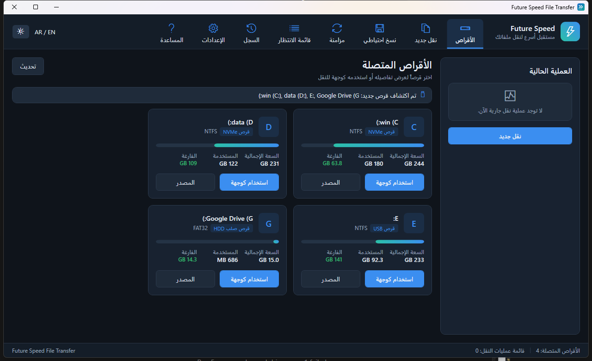

**الواجهة الإنجليزية LTR** (بضغطة على `AR / EN`) — لاحظ انقلاب التخطيط بالكامل:

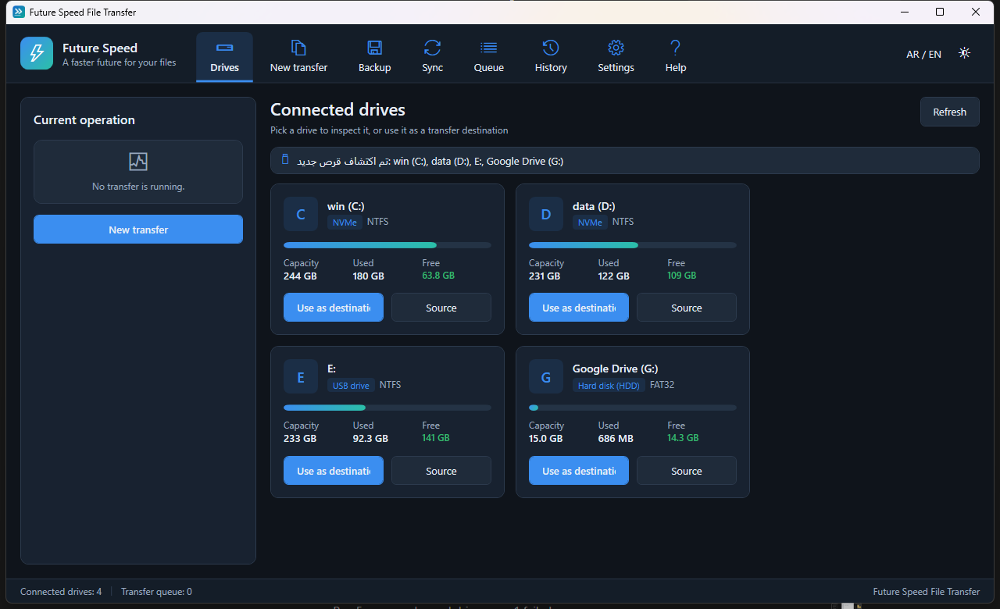

---

## 2. شاشة الأقراص

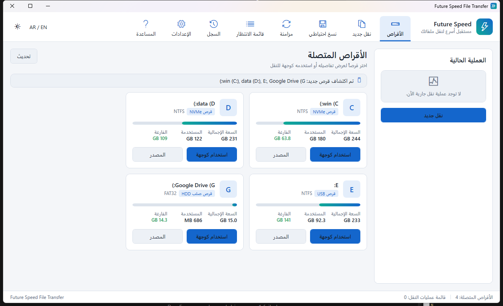

الشاشة الافتتاحية. تعرض كل قرص متصل كبطاقة مستقلة تحتوي:

- **حرف القرص** في مربع ملون، و**اسم وحدة التخزين**.
- **نوع القرص**: NVMe أو SSD أو قرص صلب HDD أو USB أو قرص شبكة — يُكتشف تلقائياً ويُستعمل
  لضبط سرعة النقل.
- **نظام الملفات**: NTFS أو FAT32 أو exFAT…
- **شريط الاستخدام** البصري.
- **السعة الإجمالية / المستخدمة / الفارغة**. تتحول المساحة الفارغة إلى اللون الأحمر عندما
  يتجاوز الاستخدام 92% لتنبهك قبل أن تختار وجهة ضيقة.
- زرّا **«استخدام كوجهة»** و**«المصدر»**: ينقلانك فوراً إلى شاشة النقل بالقرص مختاراً.

**اكتشاف الأقراص الخارجية:** عند توصيل أو فصل أي وحدة تخزين يظهر شريط إشعار أعلى البطاقات
خلال ثانيتين، وتتحدث البطاقات تلقائياً. زر **«تحديث»** يفرض التحديث فوراً.

---

## 3. شاشة نقل جديد

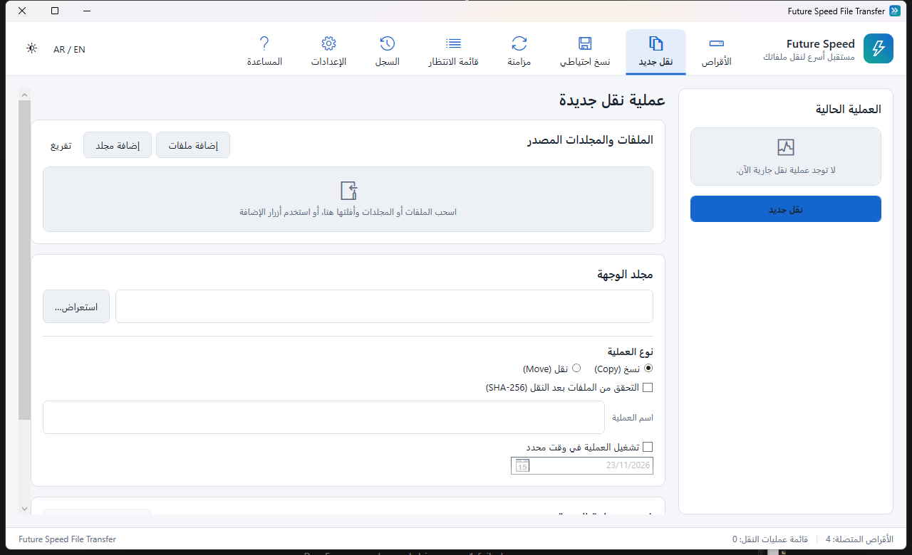

قلب البرنامج. مقسومة إلى أربع بطاقات تُملأ بالترتيب:

### بطاقة «الملفات والمجلدات المصدر»
- **إضافة ملفات** — يفتح نافذة اختيار متعدد.
- **إضافة مجلد** — يضيف مجلداً كاملاً بكل ما فيه مع الحفاظ على بنيته.
- أو ببساطة **اسحب وأفلت** في المساحة المنقطة.
- كل مصدر يظهر في قائمة، وبجانبه زر ✕ لإزالته، وزر **«تفريغ»** يمسح القائمة كلها.

### بطاقة «مجلد الوجهة»
- اكتب المسار مباشرة أو اضغط **«استعراض…»**.
- تحت الحقل تظهر **الوجهات المستعملة مؤخراً** كأزرار سريعة (آخر 10).
- **نوع العملية**: «نسخ (Copy)» أو «نقل (Move)». عند اختيار النقل يظهر تنبيه برتقالي يذكّرك
  بأن الأصل لا يُحذف إلا بعد نجاح النسخ والتحقق.
- **التحقق من الملفات بعد النقل (SHA-256)** — مربع اختيار. يبطئ العملية لأنه يقرأ كل ملف
  مرتين بعد نسخه، لكنه يعطيك ضماناً حسابياً بأن النسخة مطابقة تماماً.
- **اسم العملية** — اختياري، يظهر في القائمة والسجل والتقرير. إن تركته فارغاً يُولَّد اسم
  تلقائي مثل `Photos +2 → Backup`.
- **تشغيل العملية في وقت محدد** — فعّله واختر التاريخ لتُجدول العملية بدل تشغيلها الآن.

### بطاقة «فحص مساحة الوجهة»
اضغط **«فحص الحجم والمساحة»**. يفحص البرنامج كل الملفات ويعرض:

- ملخصاً مثل `١٢٤ ملف · 3.40 GB`.
- ثلاثة أرقام: **المساحة المطلوبة** و**المتاحة** و**الناقصة**.
- رسالة واضحة: «المساحة كافية لبدء النقل» أو «المساحة غير كافية…».

الحساب ذكي: الملفات التي ستُتخطى حسب سياستك لا تُحسب، وسياسة «اسألني» تُحسب كأسوأ حالة
(استبدال كامل)، ويُضاف هامش أمان 32 ميجابايت.

### أزرار التنفيذ
- **«أضف إلى قائمة الانتظار»** — يضيف العملية دون تشغيلها.
- **«ابدأ النقل»** — يفحص المساحة (إن لم تكن فحصت)، ثم يبدأ وينقلك إلى قائمة الانتظار.

إذا كانت المساحة غير كافية **يُمنع البدء تماماً** ويظهر حوار يشرح الأرقام. وإذا كان مجلد
الوجهة يرفض الكتابة بصلاحياتك الحالية، يسألك البرنامج قبل إعادة تشغيل نفسه بصلاحيات مدير —
ولا يطلب صلاحيات مرتفعة في أي حالة أخرى.

---

## 4. لوحة العملية الحالية

اللوحة الجانبية الثابتة. حين لا توجد عملية تعرض رسالة «لا توجد عملية نقل جارية الآن» وزر
«نقل جديد». أثناء النقل تعرض:

| المؤشر | المعنى |
|---|---|
| **اسم العملية + شارة الحالة** | جارية / موقوفة مؤقتاً / فحص / تحقق من المساحة، ونوعها نسخ أو نقل |
| **شريط التقدم + النسبة** | نسبة الإنجاز بالحجم لا بعدد الملفات |
| **اسم الملف الحالي ومساره** | يتغير مع كل ملف |
| **السرعة الحالية** | بمتوسط متحرك، فلا تقفز القيمة كل ثانية |
| **متوسط السرعة** | منذ بداية العملية |
| **الوقت المنقضي** | زمن التشغيل الفعلي |
| **الوقت المتبقي (ETA)** | محسوب من مزج السرعة اللحظية بالمتوسط العام؛ يظهر `--:--` حتى تستقر القراءة |
| **الحجم الإجمالي / تم نقله / المتبقي** | بالبايت المنسّق تلقائياً (KB/MB/GB) |
| **الملفات المكتملة** | «المكتمل / الإجمالي» |
| **تم تخطيها** و**فاشلة** | والفاشلة تظهر بالأحمر إن وُجدت |
| **الوجهة** | المسار الكامل |

**الأزرار:** إيقاف مؤقت (يتحول إلى «استكمال» عند الإيقاف) · إلغاء · فتح مجلد الوجهة.

الإيقاف المؤقت آمن تماماً: يتوقف بين مخزنين مؤقتين، فلا يُترك ملف نصف مكتوب.
وعند الإلغاء تبقى الملفات المنقولة فعلاً، ويُحذف الملف الجاري نسخه، ولا تبقى ملفات `.fspart`.

---

## 5. قائمة الانتظار

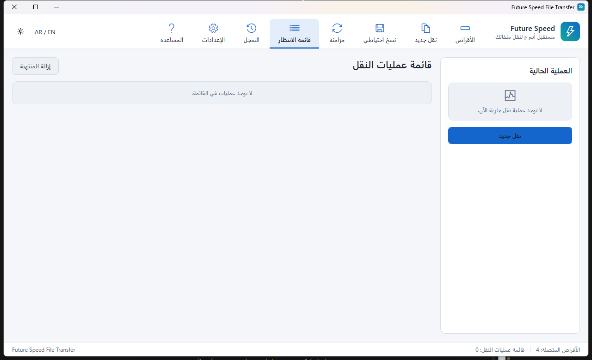

كل عملية بطاقة مستقلة تعرض الاسم والحالة والنوع والوجهة وشريط تقدم ومؤشرات مختصرة
(النسبة، المنقول من الإجمالي، الملف الحالي، السرعة، ETA) وعدّادات المكتمل والمتخطى والفاشل.

**لكل عملية:**
- **▲ ▼** — تقديم أو تأخير في الترتيب (يُحدِّث الأولوية تلقائياً).
- **📁** — فتح مجلد الوجهة.
- **🗑** — إزالة العملية من القائمة (بعد تأكيد؛ لا يمكن إزالة عملية جارية).
- **إيقاف مؤقت / استكمال / إلغاء**.
- **«إعادة محاولة الملفات الفاشلة»** — يُنشئ عملية جديدة تحتوي الملفات الفاشلة فقط، دون
  إعادة فحص الشجرة كلها.

**«إزالة المنتهية»** في الأعلى ينظّف القائمة من العمليات المكتملة.

افتراضياً تعمل **عملية واحدة في كل مرة**، لأن تشغيل عمليتين على القرص نفسه يُبطئهما معاً.
يمكنك رفع العدد من الإعدادات إذا كانت العمليات على أقراص مختلفة.

**العمليات المجدولة** تبقى بحالة «في الانتظار» ويظهر تحتها وقت التشغيل المحدد، وتبدأ وحدها
عند حلول الموعد ما دام البرنامج يعمل.

---

## 6. حوار تعارض الملفات

يظهر عندما يوجد ملف بالاسم نفسه في الوجهة وتكون سياستك «اسألني في كل مرة».

يعرض اسم الملف، وبطاقتين متقابلتين (الملف المصدر / الملف في الوجهة) فيهما الحجم وتاريخ
التعديل، وسطراً يلخّص الحكم: «الملفان متطابقان» أو «الملف المصدر أحدث» أو «الملف في الوجهة أحدث».

**الخيارات:** استبدال · تخطي · إعادة تسمية تلقائية (`تقرير (2).pdf`) · إلغاء العملية.
ومربع **«تطبيق هذا القرار على جميع التعارضات»** يحوّل اختيارك إلى سياسة لبقية العملية.

> إغلاق الحوار من زر ✕ يعني **تخطي** هذا الملف، ولا يعني الاستبدال أبداً. ولو ظهر تعارض في
> عدة ملفات متوازية فلن يظهر أكثر من حوار واحد في الوقت نفسه.

**السياسات الجاهزة** (من الإعدادات، فلا يظهر الحوار إطلاقاً):
استبدال دائماً · تخطي دائماً · إعادة تسمية تلقائية · الاحتفاظ بالأحدث · استبدال عند اختلاف
الحجم أو التاريخ.

---

## 7. حوار نقص المساحة

يظهر قبل بدء أي نقل لا تتسع له الوجهة، ويعرض بوضوح: **المساحة المطلوبة**، **المتاحة**،
**الناقصة**، واسم القرص ونظام ملفاته، وكم ستتحرر من استبدال ملفات موجودة.

في هذه الحالة **لا يوجد زر متابعة** — البرنامج يرفض البدء. يظهر زر **«متابعة على أي حال»**
في حالة واحدة فقط: حين يتعذر على النظام تحديد الحجم أو المساحة الحقيقية (بعض أقراص الشبكة
مثلاً)، ومعه تحذير صريح بأنك تتابع على مسؤوليتك.

---

## 8. السجل والتقارير والاستكمال

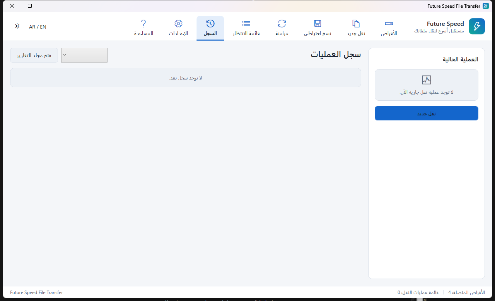

تعرض كل عملية انتهت في هذه الجلسة: الاسم والحالة ووقت الانتهاء، والحجم المنقول ومتوسط
السرعة والمدة وعدد (المكتمل / المتخطى / الفاشل).

- **«حفظ التقرير»** — يحفظ تقريراً بالصيغة المختارة أعلى الشاشة: **JSON** أو **CSV** أو **TXT**.
  التقرير يسرد كل ملف ونتيجته وبصمة SHA-256 إن كان التحقق مفعلاً، وسبب الفشل إن وُجد.
- **«فتح مجلد التقارير»** و**📁** لفتح مجلد الوجهة.
- **«الأخطاء والملفات المتخطاة»** — قسم قابل للطي يسرد كل ملف لم يُنقل مع السبب.

إن كان خيار «حفظ تقرير تلقائياً» مفعّلاً (وهو الافتراضي) يُحفظ تقرير بعد كل عملية دون تدخل.

### استكمال العمليات المقطوعة
إذا أُغلق البرنامج أو تعطّل أثناء نقل، يظهر عند التشغيل التالي **شريط برتقالي** في أعلى
شاشة السجل بعنوان «عمليات قابلة للاستكمال»، وتحته كل عملية غير مكتملة مع عدد الملفات
المنجزة من الإجمالي ووقت آخر حفظ، وزرّان: **«استكمال»** و**«تجاهل»**.

الاستكمال لا يعيد نسخ ما اكتمل: الحالة محفوظة في `%APPDATA%\FutureSpeed\state` كل ثلاث ثوانٍ.

---

## 9. النسخ الاحتياطي

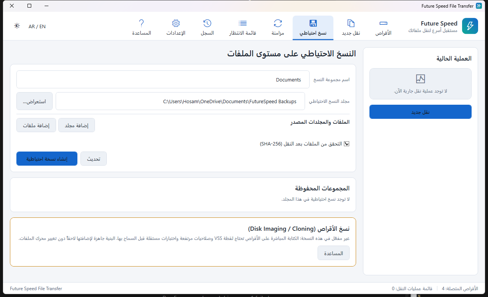

نسخ احتياطي على مستوى الملفات والمجلدات:

1. اكتب **اسم مجموعة النسخ** (مثلاً `Documents`).
2. اختر **مجلد النسخ الاحتياطي** (الافتراضي `Documents\FutureSpeed Backups`).
3. أضف المجلدات والملفات المطلوبة.
4. فعّل التحقق SHA-256 إن أردت نسخة موثقة بالبصمات.
5. اضغط **«إنشاء نسخة احتياطية»**.

كل تشغيل يُنشئ مجلداً مستقلاً بطابع زمني:
`<المجلد>\<اسم المجموعة>\2026-11-23_231500`، فلا تُستبدل نسخة قديمة أبداً. وداخل كل مجموعة
ملف `futurespeed-backup.json` يصف محتواها: المصادر، عدد الملفات، الحجم، وبصمة كل ملف.

قائمة **«المجموعات المحفوظة»** تعرض كل النسخ في المجلد مع تاريخها وحجمها وعدد ملفاتها
وما إذا كانت موثّقة بالتحقق، وزر لفتح أي مجموعة.

### نسخ الأقراص (Disk Imaging / Cloning)
قسم في أسفل الشاشة بإطار تحذيري: **غير مفعّل في هذه النسخة**. السبب معروض في الواجهة:
الكتابة المباشرة على الأقراص تحتاج لقطة VSS وصلاحيات مرتفعة واختبارات مستقلة. البنية
البرمجية جاهزة لإضافته لاحقاً دون تغيير محرك الملفات.

---

## 10. المزامنة

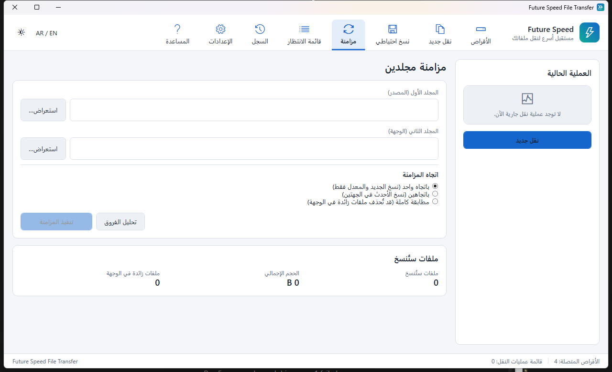

لمطابقة مجلدين:

1. اختر **المجلد الأول (المصدر)** و**المجلد الثاني (الوجهة)**.
2. اختر الاتجاه:
   - **باتجاه واحد** — ينسخ الجديد والمعدّل فقط، ولا يحذف شيئاً أبداً. (الأكثر أماناً)
   - **باتجاهين** — ينسخ الأحدث في كل جهة، ولا يحذف شيئاً.
   - **مطابقة كاملة** — يجعل الوجهة نسخة طبق الأصل، ويكشف الملفات الزائدة فيها.
3. اضغط **«تحليل الفروق»** — يقارن بالحجم وتاريخ التعديل (بتسامح ثانيتين لأن FAT32 وبعض
   أقراص الشبكة تخزّن التواريخ بدقة أقل) ويعرض: عدد الملفات التي ستُنسخ، حجمها، وعدد
   الملفات الزائدة.
4. اضغط **«تنفيذ المزامنة»** لإضافتها كعملية في قائمة الانتظار.

**«حذف الملفات الزائدة»** يظهر في وضع المطابقة الكاملة فقط، ويطلب تأكيداً صريحاً يذكر عدد
الملفات لأن الحذف نهائي. لن يقبل البرنامج مجلدين أحدهما داخل الآخر.

---

## 11. الإعدادات

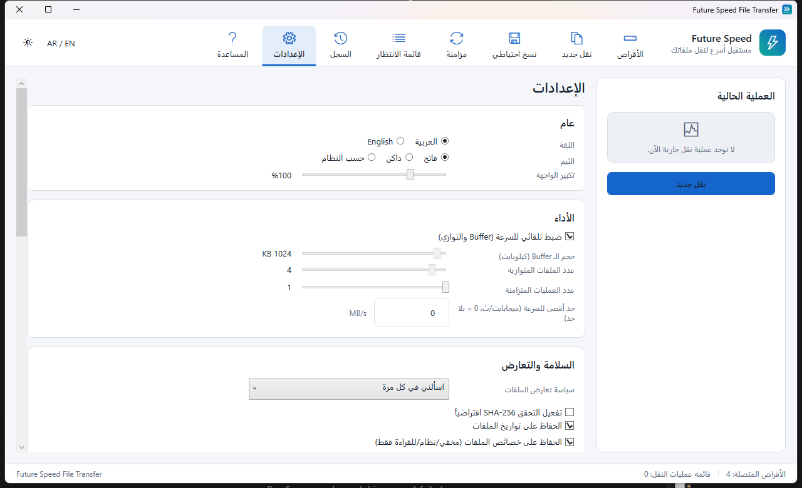

### عام
- **اللغة**: العربية / English — تُطبّق فوراً للمعاينة.
- **الثيم**: فاتح / داكن / حسب النظام.
- **تكبير الواجهة**: من 80% إلى 160% بخطوات 10% — مفيد للشاشات عالية الدقة.

### الأداء
- **ضبط تلقائي للسرعة** (مفعّل افتراضياً): يختار البرنامج حجم الـ Buffer وعدد الملفات
  المتوازية حسب نوع القرصين. اتركه مفعّلاً إلا إن كنت تعرف ما تفعل.
- **حجم الـ Buffer**: 4 كيلوبايت – 16 ميجابايت (يُفعَّل عند إيقاف الضبط التلقائي).
- **عدد الملفات المتوازية**: 1 – 32. القرص الصلب التقليدي يفضّل **1** لأن التوازي يسبب seek.
- **عدد العمليات المتزامنة**: 1 – 8 عمليات نقل في وقت واحد.
- **حد أقصى للسرعة** بالميجابايت/الثانية (0 = بلا حد) — مفيد كي لا يخنق النقل اتصال الشبكة.

### السلامة والتعارض
- **سياسة تعارض الملفات** (الست المذكورة في القسم 6).
- **تفعيل التحقق SHA-256 افتراضياً**.
- **الحفاظ على تواريخ الملفات** و**الحفاظ على الخصائص** (مخفي / نظام / للقراءة فقط).
- **تمكين استكمال العمليات بعد الإغلاق**.

### الإشعارات
إشعار صوتي عند الانتهاء · إشعار Windows · فتح مجلد الوجهة بعد الانتهاء · حفظ تقرير تلقائي ·
صيغة التقرير الافتراضية.

### المسارات
مجلدات السجلات والتقارير والنسخ الاحتياطي — كلها قابلة للتغيير.

### بيانات تجريبية
زر **«إنشاء بيانات تجريبية»** ينشئ شجرة ملفات بأحجام متنوعة (ملفات صغيرة كثيرة + ملفات
كبيرة) داخل مجلد البرنامج المؤقت، لتجربة كل الوظائف دون أي خطر على ملفاتك.

في الأسفل: **«حفظ»** لتثبيت التغييرات، و**«تفريغ»** للعودة إلى الإعدادات الافتراضية.

---

## 12. المساعدة

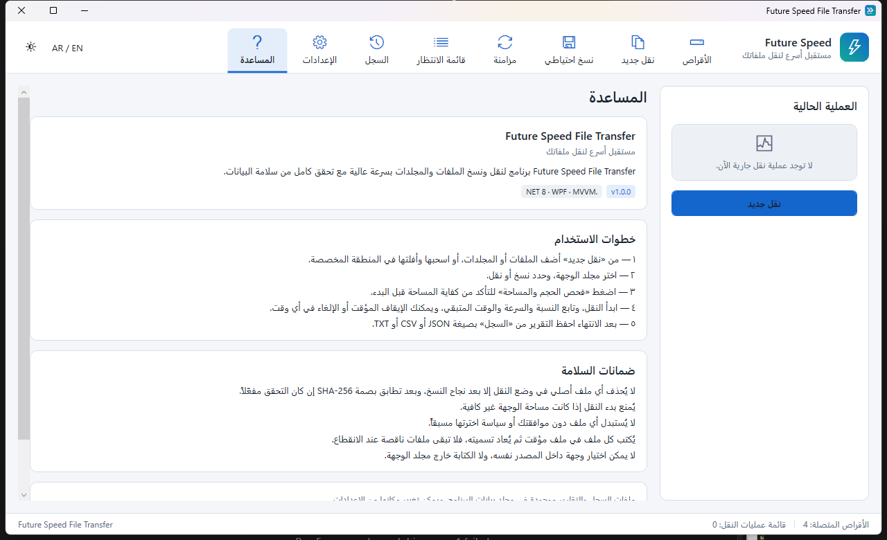

تعرض اسم البرنامج وإصداره، وخطوات الاستخدام الخمس، وضمانات السلامة، وأزراراً مباشرة لفتح
مجلدات السجلات والتقارير وبيانات البرنامج.

---

## 13. تكامل مستكشف الملفات

> متاح من الإصدار **1.1.0**. اختياري بالكامل، وقابل للإلغاء في أي لحظة.

### ما الذي يضيفه فعلاً
ثلاثة أوامر في قائمة الزر الأيمن داخل مستكشف الملفات:

| الأمر | يظهر على | ماذا يفعل |
|---|---|---|
| **نسخ بواسطة Future Speed** | ملف · مجلد · تحديد متعدد | يضع العناصر في حافظة ويندوز بعلامة «نسخ» |
| **نقل بواسطة Future Speed** | ملف · مجلد · تحديد متعدد | يضعها في الحافظة بعلامة «قص» |
| **لصق بواسطة Future Speed** | مجلد · خلفية المجلد | يبدأ النقل إلى هذا المجلد في نافذة مصغرة |

يمكنك خلط الأمرين مع ويندوز: انسخ بـ `Ctrl+C` العادي ثم استخدم **لصق بواسطة Future Speed**،
أو انسخ بأمر Future Speed ثم الصق بـ `Ctrl+V` العادي — الحافظة واحدة في الحالتين.

### التفعيل والإلغاء
**الإعدادات ← تكامل Windows**:
- اختر النطاق: **للمستخدم الحالي** (الافتراضي، بلا صلاحيات مدير) أو **لكل مستخدمي الجهاز**.
- اضغط **تفعيل التكامل**. سيعرض البرنامج مربع موافقة يسرد **المفاتيح الستة** التي ستُكتب،
  ولا يُكتب أي شيء قبل موافقتك.
- **إلغاء التكامل واستعادة سلوك Windows** يحذف المفاتيح كاملة.

يمكن أيضاً تفعيله أثناء التثبيت بتأشير مهمة «تكامل مستكشف الملفات»، ويزيله إلغاء التثبيت تلقائياً.

### ماذا يُكتب في سجل Windows بالضبط
ستة مفاتيح فقط، تحت `HKEY_CURRENT_USER\Software\Classes` (أو `HKEY_LOCAL_MACHINE` إن اخترت
نطاق الجهاز):

```
*\shell\FutureSpeed.Copy                        نسخ بواسطة Future Speed
*\shell\FutureSpeed.Move                        نقل بواسطة Future Speed
Directory\shell\FutureSpeed.Copy                نسخ بواسطة Future Speed
Directory\shell\FutureSpeed.Move                نقل بواسطة Future Speed
Directory\shell\FutureSpeed.Paste               لصق بواسطة Future Speed
Directory\Background\shell\FutureSpeed.Paste    لصق بواسطة Future Speed
```

كل مفتاح يحمل اسم الأمر وأيقونته و`MultiSelectModel=Player` (ليفتح نسخة واحدة لكل التحديد)
ومفتاحاً فرعياً `command` فيه مسار البرنامج ومعاملاته.

### حدود صريحة يجب معرفتها
- **Future Speed ليس «الناسخ الافتراضي» لويندوز.** `Ctrl+C` و`Ctrl+V` يبقيان سلوك ويندوز
  نفسه تماماً. لا توفّر ويندوز أي طريقة مدعومة لاستبدال محرك النسخ، والطرق الالتفافية (حقن
  مكوّن داخل `explorer.exe` أو اعتراض لوحة المفاتيح عالمياً) غير آمنة وتؤثر في كل البرامج،
  ولم تُستخدم هنا إطلاقاً.
- **في ويندوز 11** تظهر الأوامر داخل **«إظهار المزيد من الخيارات»** (`Shift+F10`)؛ إظهارها في
  القائمة الأولى يحتاج حزمة MSIX موقّعة، وهي خارج نطاق هذه النسخة.
- البرنامج يقرأ من الحافظة **قائمة الملفات فقط** (`CF_HDROP`) وعلامة النسخ/القص
  (`Preferred DropEffect`). الحافظة التي تحوي نصاً أو صورة تُترك وشأنها تماماً ولا تُسجَّل.
- إن نقلت مجلد البرنامج أو حذفته، تعرض الإعدادات الحالة **«يحتاج إعادة تفعيل»** — اضغط
  «تفعيل التكامل» مرة أخرى.

---

## 14. نافذة النقل المصغرة

عند بدء أي عملية من مستكشف الملفات تُفتح **هذه النافذة وحدها** — لا تُفتح النافذة الرئيسية.

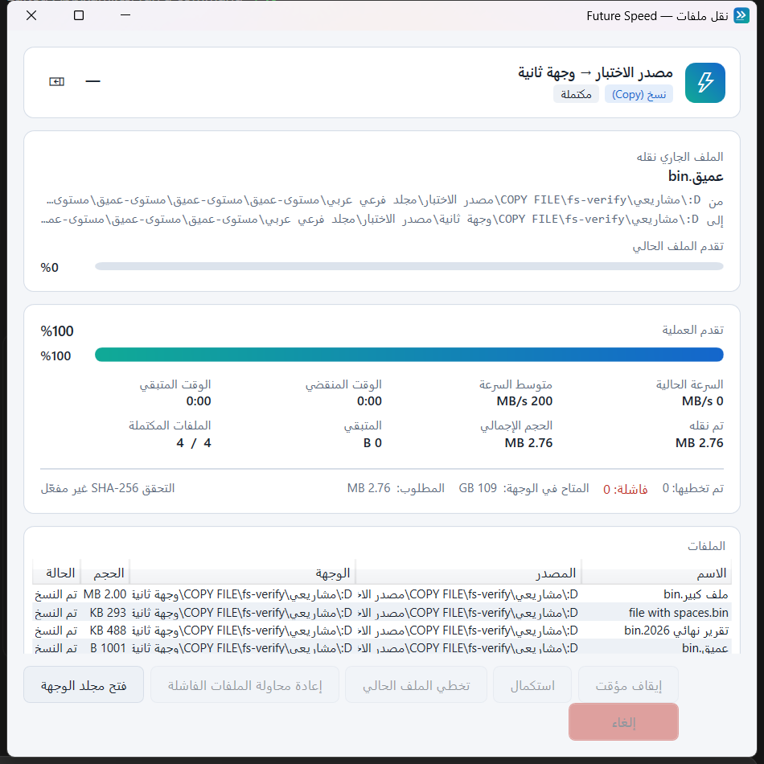

وبالإنجليزية LTR:

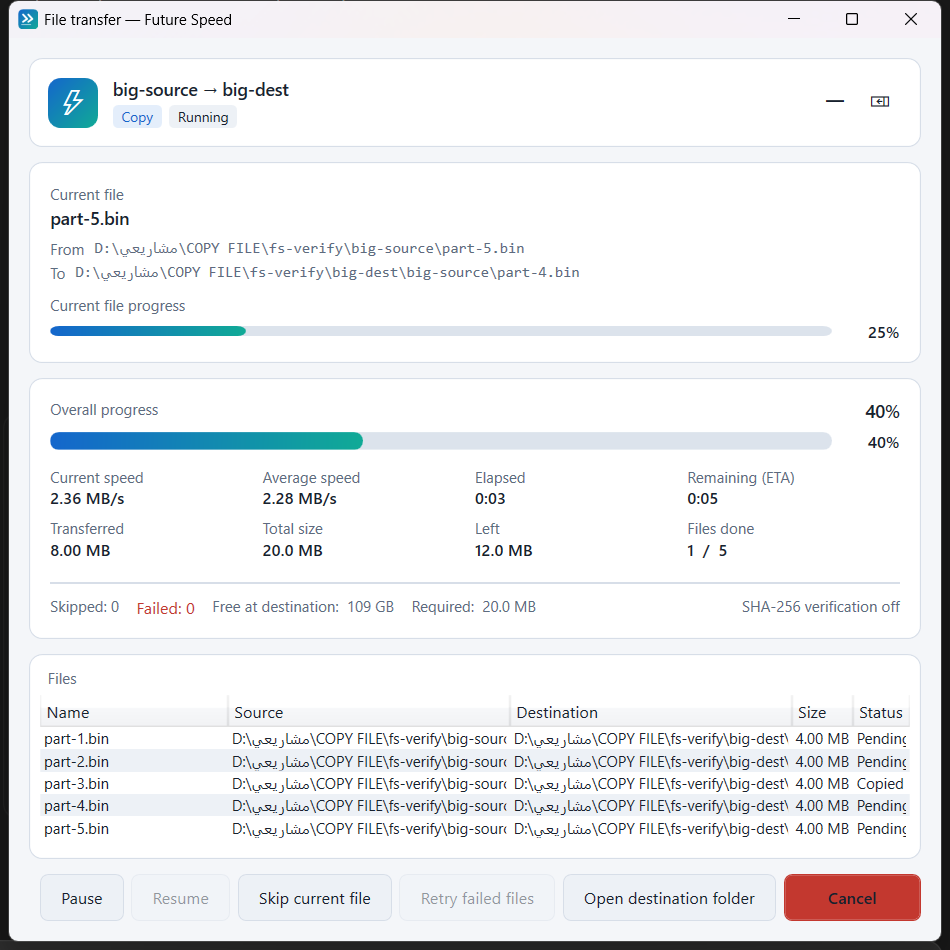

**ما تعرضه:** الملف الجاري نقله ومساري مصدره ووجهته، شريط تقدم للملف الحالي وآخر للعملية
كاملة مع نسبة كل منهما، السرعة الحالية ومتوسطها، الوقت المنقضي والمتبقي، المنقول والإجمالي
والمتبقي، عدد الملفات المكتملة من الإجمالي والمتخطاة والفاشلة، المساحة المتاحة في الوجهة
والمطلوبة، حالة التحقق SHA-256، وقائمة بكل الملفات بأعمدة: الاسم والمصدر والوجهة والحجم والحالة.

**أزرارها:** إيقاف مؤقت · استكمال · **تخطي الملف الحالي** · إعادة محاولة الملفات الفاشلة ·
فتح مجلد الوجهة · إلغاء. وفي أعلى النافذة زرّان: **فتح النافذة الرئيسية** و**تصغير إلى منطقة
الإشعارات** (تعود بالنقر على الأيقونة).

**سلوكها:**
- «تخطي الملف الحالي» يتخلى عن هذا الملف وحده ويحذف ملفه المؤقت، وتستمر بقية العملية.
- «إلغاء» يطلب تأكيداً، ولا يحذف أي ملف أصلي سليم؛ الملفات المنقولة تبقى.
- إغلاق النافذة أثناء النقل **لا يوقفه** — تُصغَّر إلى منطقة الإشعارات.
- النافذة قابلة لتغيير الحجم، وتدعم الثيم الفاتح والداكن وشاشات High DPI.
- إن بدأت عدة عمليات من Explorer، لكل واحدة نافذتها، وكلها داخل **نسخة واحدة** من البرنامج.

---

## 15. ملفات لم تُنقل والتقرير المفصّل

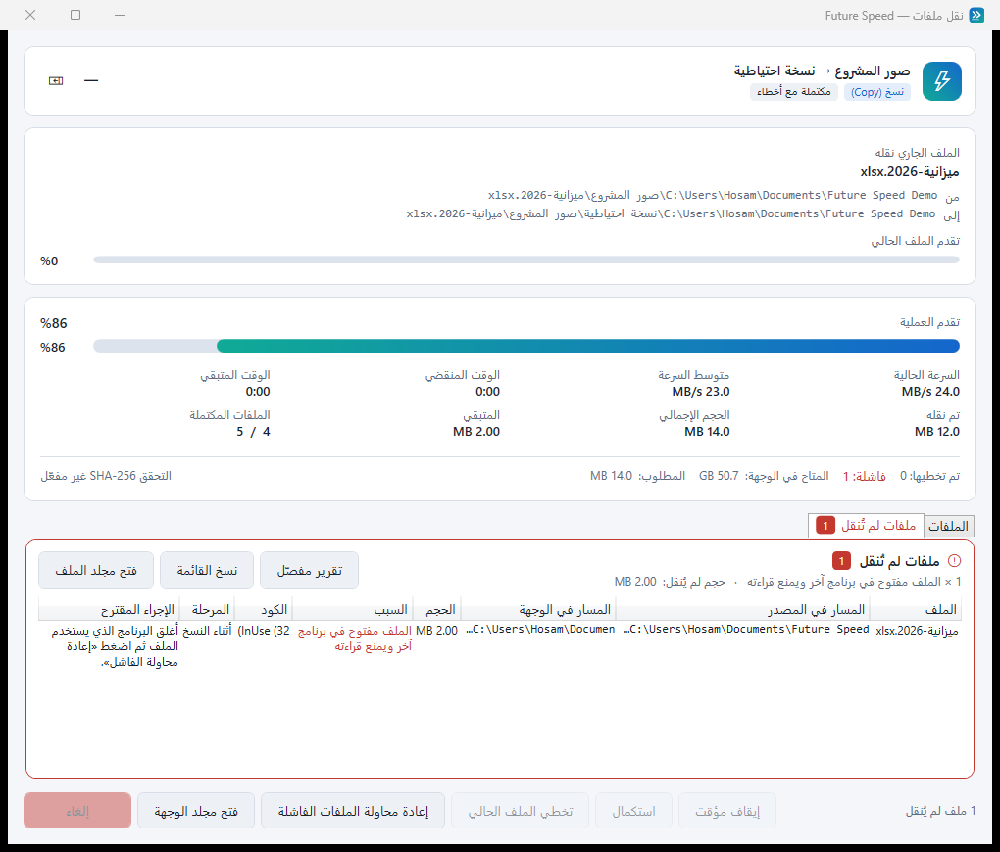

لا تنتهي عملية بها فشل بعدّاد فقط. أي ملف لم يُنقل يظهر في لوحة **«ملفات لم تُنقل»**
في ثلاثة أماكن: تبويب داخل نافذة النقل المصغّرة يفتح نفسه عند أول فشل، وبطاقة العملية
في **قائمة الانتظار**، وبطاقة العملية في **السجل**. لوحة العملية الحالية (الجانبية)
تكتفي بتنبيه مختصر وزرّي «تقرير مفصّل» و«نسخ القائمة» لضيق مساحتها.

### ماذا تعرض اللوحة لكل ملف
| العمود | المعنى |
|---|---|
| الملف | اسم الملف |
| المسار في المصدر | المسار الكامل كما هو على القرص (مرّر الفأرة فوقه لرؤيته كاملاً) |
| المسار في الوجهة | المكان الذي كان سيُكتب فيه |
| الحجم | حجم الملف الذي لم يُنقل |
| السبب | جملة مفهومة: «الملف مفتوح في برنامج آخر ويمنع قراءته»، «لا توجد صلاحية…» |
| الكود | الكود التقني مع رقم Windows الأصلي، مثل `InUse (32)` |
| المرحلة | أثناء النسخ / أثناء التحقق / أثناء فحص المصدر |
| الإجراء المقترح | ما تفعله لإتمام نقله |

أعلى اللوحة سطر يجمع الأسباب («1 × الملف مفتوح في برنامج آخر…») وحجم ما لم يُنقل.

### الأزرار
- **تقرير مفصّل** — ينشئ تقرير HTML ويفتحه في المتصفح.
- **نسخ القائمة** — ينسخ كل المسارات والأسباب والإجراءات كنص جاهز للصق في رسالة.
- **فتح مجلد الملف** — يفتح المجلد الحاوي للملف المحدد في المستكشف.
- **إعادة محاولة الملفات الفاشلة** — ينشئ عملية جديدة بالملفات الفاشلة وحدها، بعد أن
  تعالج السبب (أغلقت البرنامج الذي يحتجز الملف مثلاً).

### التقرير المفصّل (HTML)

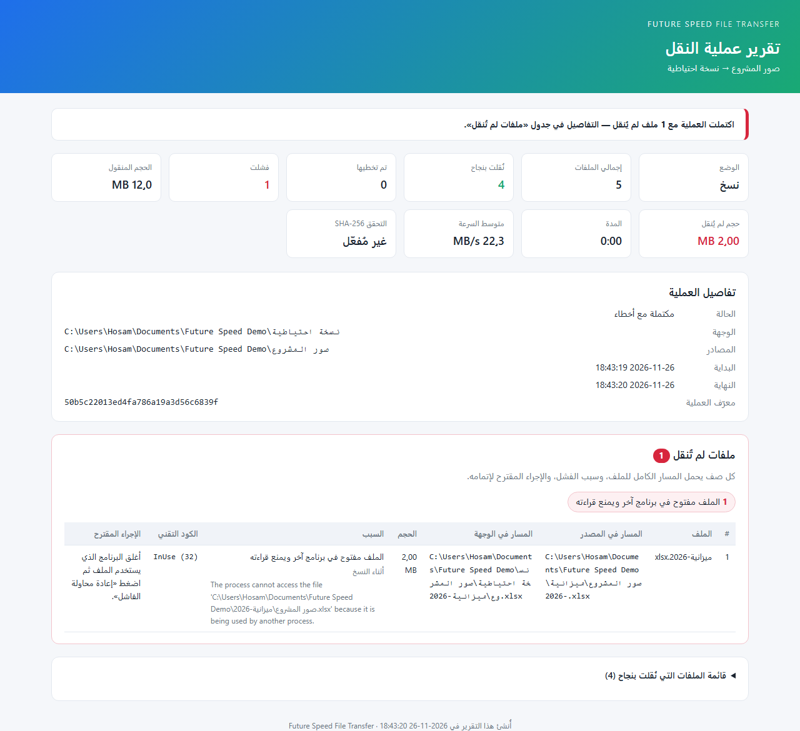

يُنشأ تلقائياً بعد أي عملية بها فشل ويُحفظ في `%APPDATA%\FutureSpeed\reports`، بلغة
الواجهة واتجاهها، ويحتوي:

1. **حُكم العملية** في سطر واحد (اكتملت بنجاح / اكتملت مع N ملف لم يُنقل / أُلغيت…).
2. **بطاقات ملخّص:** الوضع، إجمالي الملفات، ما نُقل، ما تُخطّي، ما فشل، الحجم المنقول،
   حجم لم يُنقل، المدة، متوسط السرعة، حالة التحقق.
3. **تفاصيل العملية:** الحالة، الوجهة، المصادر، البداية والنهاية، معرّف العملية.
4. **جدول «ملفات لم تُنقل»** بالمسارات الكاملة والسبب والكود والإجراء المقترح.
5. قائمة الملفات المتخطاة، ثم قائمة قابلة للطي بكل ما نُقل بنجاح مع بصمات SHA-256.

الصفحة مستقلة تماماً (بلا ملفات خارجية) فيمكن إرسالها بالبريد أو طباعتها كما هي
(`Ctrl+P`). ولمن يريد معالجة آلية: تقرير **JSON** يحمل قسم `failures` مستقلاً بكل
المسارات والأسباب والأكواد، وتقرير **CSV** يفتح في Excel بأعمدة السبب والكود والإجراء.

### الأسباب التي يفرّقها البرنامج
ملف مفتوح في برنامج آخر · لا صلاحية · الملف لم يعد موجوداً · المسار أطول من المسموح ·
القرص ممتلئ · قرص الوجهة غير متاح · الوجهة محمية من الكتابة · خطأ شبكة · اسم غير صالح ·
خطأ قرص (قطاع تالف) · عدم تطابق SHA-256.

> الملفات التي يتعذّر على البرنامج حتى **فحصها** (مجلد مرفوض الصلاحية مثلاً) تظهر في
> القائمة نفسها بمرحلة «أثناء فحص المصدر»، فلا يختفي شيء بصمت.

---

## 16. سيناريوهات عملية

### نقل مجلد ضخم إلى قرص USB
1. وصّل القرص وانتظر ظهوره في «الأقراص» (ثانيتان).
2. اضغط **«استخدام كوجهة»** على بطاقته.
3. اسحب المجلد المطلوب وأفلته في النافذة.
4. اضغط **«فحص الحجم والمساحة»** — لو كان القرص لا يتسع فلن يبدأ النقل أصلاً.
5. اضغط **«ابدأ النقل»** وتابع من اللوحة الجانبية.

> نصيحة: مع أقراص USB اترك الضبط التلقائي مفعّلاً؛ البرنامج يخفض التوازي إلى عمليتين وحجم
> الـ Buffer إلى 512 كيلوبايت، وهو الأسرع عملياً على هذه الأقراص.

### نسخ احتياطي أسبوعي موثّق
1. شاشة **نسخ احتياطي** → اسم المجموعة `Work`.
2. أضف مجلدات العمل، وفعّل **التحقق SHA-256**.
3. **«إنشاء نسخة احتياطية»** — تُنشأ مجموعة جديدة بطابع زمني مع ملف بصمات، دون المساس
   بالنسخ السابقة.

### نقل آمن (Move) لمجلد مهم
1. اختر المصدر والوجهة، واختر **نقل (Move)**.
2. فعّل **التحقق SHA-256**.
3. ابدأ. لن يُحذف أي ملف أصلي إلا بعد نسخه **وتطابق بصمته**؛ وأي ملف يفشل تحققه يُحذف من
   الوجهة ويبقى أصله سليماً ويُسجَّل في التقرير.

### مزامنة مجلد مشروع بين جهازين عبر الشبكة
1. شاشة **مزامنة** → المجلد المحلي كمصدر، ومجلد الشبكة كوجهة.
2. اختر **باتجاه واحد** أول مرة، و**باتجاهين** إن كنت تعدّل من الجهتين.
3. **تحليل الفروق** ثم **تنفيذ المزامنة**.
4. من الإعدادات ضع **حد سرعة** مناسباً إن كنت تستعمل الشبكة لأعمال أخرى.

### تشغيل نقل كبير ليلاً
في شاشة «نقل جديد» فعّل **«تشغيل العملية في وقت محدد»** واختر الموعد، ثم **«أضف إلى قائمة
الانتظار»**. اترك البرنامج يعمل، وستبدأ العملية وحدها.

---

## 17. أسئلة شائعة وحل المشكلات

**لماذا الزر «ابدأ النقل» لا يفعل شيئاً؟**
غالباً لم تختر مصدراً أو وجهة. ستظهر رسالة توضح الناقص.

**البرنامج رفض الوجهة التي اخترتها.**
لا يمكن أن تكون الوجهة هي المصدر نفسه أو مجلداً داخله — وإلا لنسخ المجلد داخل نفسه بلا نهاية.

**ظهرت رسالة «تحتاج هذه العملية صلاحيات مدير».**
مجلد الوجهة يرفض الكتابة بحسابك الحالي (مثل `C:\Program Files`). وافق لإعادة التشغيل بصلاحيات
مرتفعة، أو اختر مجلداً آخر. البرنامج لا يطلب هذه الصلاحيات في الحالات العادية.

**النقل أبطأ من المتوقع.**
تحقق من: نوع القرصين على بطاقتي الأقراص (قرص صلب تقليدي سيكون أبطأ حتماً)، ومن أن حد السرعة
في الإعدادات = 0، ومن أن التحقق SHA-256 غير مفعّل (يقرأ كل ملف مرتين إضافيتين)، ومن أن
الضبط التلقائي مفعّل.

**توقفت العملية فجأة برسالة «الوجهة لم تعد متاحة».**
فُصل القرص أو انقطعت الشبكة. الملفات المنقولة سليمة، والعملية قابلة للاستكمال من شاشة السجل
بعد إعادة التوصيل.

**ماذا تعني ملفات `.fspart`؟**
هي ملفات مؤقتة أثناء الكتابة، تُعاد تسميتها عند اكتمال الملف. لا تبقى بعد عملية ناجحة أو
ملغاة؛ إن وجدت واحداً بعد انقطاع كهرباء فاحذفه بأمان.

**أين تُحفظ بياناتي؟**

```
%APPDATA%\FutureSpeed\
├── settings.json   الإعدادات
├── logs\           سجلات يومية (تُحفظ 14 يوماً)
├── reports\        تقارير العمليات
├── state\          نقاط استعادة العمليات غير المكتملة
└── demo-data\      البيانات التجريبية إن أنشأتها
```

إلغاء تثبيت البرنامج **لا يحذف** هذا المجلد.

**لا أرى أوامر Future Speed في قائمة الزر الأيمن.**
في ويندوز 11 اضغط **«إظهار المزيد من الخيارات»** أو Shift+F10. وإن لم تظهر، افتح
الإعدادات ← تكامل Windows وتأكد أن الحالة «مفعّل»؛ إن ظهرت «يحتاج إعادة تفعيل» فاضغط
«تفعيل التكامل» مجدداً.

**هل يصبح Future Speed بديلاً عن النسخ العادي في ويندوز؟**
لا. Ctrl+C وCtrl+V يبقيان كما هما تماماً؛ الإضافة هي أوامر في القائمة فقط. لا توجد طريقة
مدعومة وآمنة في ويندوز لاستبدال محرك النسخ نفسه.

**هل يدعم البرنامج المسارات الطويلة جداً؟**
نعم، أطول من 260 حرفاً، عبر استخدام مسارات Win32 الممتدة في كل العمليات.

**هل يمكن نقل ملف بحجم 500 جيجابايت؟**
نعم. استهلاك الذاكرة ثابت ولا يتناسب مع حجم الملف؛ يُحجز مكان الملف في الوجهة مسبقاً، وتُكتشف
مشكلة المساحة فوراً لا بعد ساعة.
